# Architecture

## Repository role

The maintained output is a pair of unsigned ANGLE dynamic libraries for an exact Chrome Stable version and macOS architecture. The repo stores public source pins, the Family 1 patch, the recipe, tests, and generic local tooling in `src/maintenance_angle/`. It does not store Chrome apps, generated binaries, user profiles, signing material, private receipts, or device observations.

## Processing paths

```mermaid
flowchart LR
  VH[Mac Stable release data] --> TAG[Exact Chromium tag]
  TAG --> DEPS[chrome/VERSION and DEPS pins]
  DEPS --> PATCH[Fixed patch and source checks]
  PATCH --> POLICY[Synthetic Family 1 policy tests]
  POLICY --> BUILD[Two-library ANGLE build]
  BUILD --> VERIFY[Manifest, license, architecture, unsigned checks]
  VERIFY --> INDEX[Actions artifact and version index]
  INDEX -. manual exact-version fetch .-> LOCAL[Owner-selected Chrome copy]
  LOCAL --> SIGN[Owner signing, strict verification]
  SIGN --> ACCEPT[Owner device acceptance and adoption decision]
```

CI output states include `STABLE_RELEASE_DETECTED`, `RETRY_REQUESTED`, `CI_BUILD_FAILED`, `CI_BUILD_INTERRUPTED`, `ARTIFACT_METADATA_MISMATCH`, and `CI_BUILD_SUCCEEDED`. A successful candidate still reports `device_compatibility=not-assessed` and `adoption_status=not-assessed`.

## Source of truth

`catalog/chrome/` maps a Chrome four-part version to its Chromium commit, DEPS-pinned ANGLE commit, and exact baseline patchset/recipe IDs and hashes. `catalog/angle-revisions/` records ANGLE source revisions. `catalog/patchsets/` binds the patch hash, source blobs, ordered diff paths, and the default-selection marker for unregistered ANGLE. `catalog/recipes/` fixes target, runner, Xcode/SDK, GN arguments, depot_tools revision, and the new-version default marker. Known versions use their source-record binding; unregistered versions require one unique candidate patchset and recipe pair. Ambiguous or missing mappings fail closed, and an explicit alternate pair is marked as a trial. Build keys hash the selected source, patch, recipe, selection mode, and workflow commit.

The catalog is reviewed source, not an automated database. The monitor writes no catalog changes, commits, PRs, issues, tags, releases, or notifications.

## Supported entrypoints and retired experiments

The supported workflow entrypoints are the Stable monitor/candidate builder, read-only pull request validation, and fixed Chrome 156 baseline reproduction. The local helper is `scripts/local-angle.py`.

The maintenance migration removed the old standalone ANGLE, Phase 3D, full-Chromium diagnostic, preflight, test-stub, and unsigned-browser workflows together with their dedicated support files. Shared CDP and synthetic media/WebGL probes remain under `src/probes/` and use package imports; they no longer import from `scripts/page-recovery`. Removing source files from the maintained tree did not erase old workflow runs or artifacts, or copies on other branches.

Publication privacy files and hooks remain unchanged. Work on maintenance changes starts from a verified current `main` tip in a dedicated local repair branch. The existing safe-push rules remain in force; no earlier branch or PR approval carries over to new work. Commit, publication, PR operations, and integration each require their applicable separate owner approval. See the [publication plan](main-publication-plan.md).
